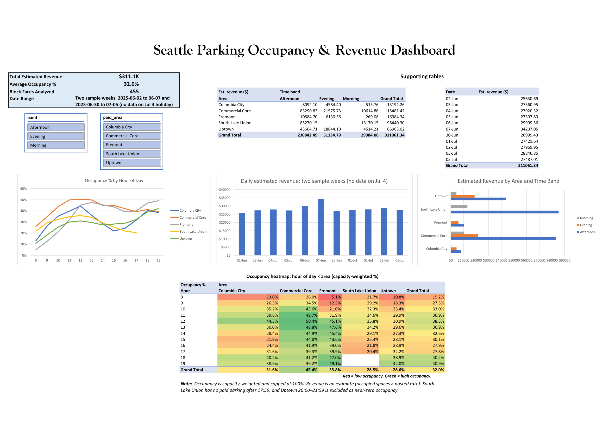

# Seattle Paid Parking: Occupancy and Pricing Analysis

An end-to-end analysis of 3.49 million real paid-parking occupancy readings from Seattle's on-street parking, built with **PostgreSQL** and **Excel** (Python for the data download). It finds where and when parking is busy, models estimated revenue from the city's published hourly rates, and tests what the city's own pricing rule would do to revenue.



## Business questions

1. Where and when is paid parking underused, and where is it overcrowded?
2. How much revenue do those patterns represent at the posted rates?
3. What would the city's own occupancy-based pricing rule do to revenue, and what would a more targeted rule do?

## Key findings

Two sample weeks, 11 days with data (2025-06-02 to 06-07 and 2025-06-30 to 07-05), 455 block faces in 5 paid areas.

| Metric | Value |
|---|---|
| Raw readings loaded | 3,492,783 |
| Block-face-hours after cleaning | 51,626 |
| Estimated revenue (modelled, 11 days) | about $311K |
| Occupancy (capacity-weighted, capped at 100%) | 32.0% |

- **Revenue is concentrated.** Commercial Core and South Lake Union earn 68.8% of estimated revenue. Afternoon hours earn 74.2%. The top fifth of block faces earns 48.5%.
- **Most blocks sit below the city's target.** SDOT's rate rule aims for 70-85% occupancy. 95.6% of the 1,172 block-face and time-band combinations are below 70%, 3.7% are inside the target and 0.7% are above 85%.
- **A few blocks are persistently full.** Madison St between Post Ave and 1st Ave is full in 68.4% of minutes. Runs of 10-12 hours with the block full for at least half the minutes repeat across both sample weeks.
- **Applying the city's rule everywhere would cut revenue.** Because most blocks are below 70%, the rule lowers rates almost everywhere, and modelled revenue falls by 3.7% to 16.9% depending on the assumed elasticity. Raising rates only on already-busy blocks never loses revenue in the model (0.0% to +1.4%).
- **One pattern did not replicate.** Uptown's Saturday uplift of +14.7 points in week 1 was +0.9 in week 2. Weekend effects should not be generalised from a single week.

Full write-up: [docs/findings.md](docs/findings.md). Cleaning and data checks: [docs/data_quality_report.md](docs/data_quality_report.md).

## How revenue is defined

The source dataset has **no revenue and no rate**: its rate column is empty (NULL) on every row. Revenue here is a model:

> estimated revenue = average paid vehicles in the hour (capped at the space count) × SDOT posted hourly rate for that sub-area and time band

Rates come from SDOT's published schedule effective 2025-03-10 ([SDOT blog](https://sdotblog.seattle.gov/2025/03/07/street-parking-rate-update-march-10-2025/)). It is an estimate of demand at posted prices, **not actual collections**. It ignores event pricing, holidays, permits and people who do not pay.

## Pricing scenarios

The model changes a rate by $0.50 (down below 70% occupancy, up above 85%, unchanged in between, floor $0.50) and moves occupancy with a constant elasticity, capped at capacity. Change in estimated revenue:

| Scenario | e = -0.1 | e = -0.3 | e = -0.5 | e = -1.0 |
|---|---:|---:|---:|---:|
| S1 SDOT rule per sub-area and time band | -16.9% | -14.0% | -11.1% | -3.7% |
| S2 SDOT rule per block face and time band | -15.3% | -12.6% | -9.8% | -2.9% |
| S3 raise rates only where occupancy is 70%+ | +1.4% | +1.0% | +0.7% | 0.0% |

**Elasticity is assumed, not estimated.** The values bracket published findings: SFpark's first year averaged about -0.4 ([Access Magazine](https://www.accessmagazine.org/fall-2013/sfpark-pricing-parking-demand/)) and a California Air Resources Board literature review reports an average of about -0.3 ([CARB](https://ww2.arb.ca.gov/sites/default/files/2020-06/Impacts_of_Parking_Pricing_Based_on_a_Review_of_the_Empirical_Literature_Technical_Background_Document_0.pdf)). -1.0 is a stress case. I tried to estimate elasticity from the 11:00 rate step in the data, but time-of-day demand growth swamped any price effect, so the results are scenarios, not forecasts. The 70-85% target and the $0.50 steps follow SDOT's published method ([SDOT 2022 Paid Parking Annual Report](https://www.seattle.gov/documents/Departments/SDOT/ParkingProgram/PaidParking/2022_PaidParking_Annual_Report.pdf)). The model does not include SDOT's larger $1.00 step above 100% occupancy.

## Recommendations

Based on the findings (details and caveats in [docs/findings.md](docs/findings.md#7-recommendations)):

- Raise rates only on block-face and time-band combinations already at 70%+ occupancy. The model shows a small gain (about 0.7% to 1.4%) and no downside.
- Do not apply the occupancy rule across the board if revenue is the goal: it trades 3.7% to 16.9% of modelled revenue for more open spaces.
- Set rates per block face where a single sub-area rate hides both full and empty blocks.
- Pilot any change before rolling it out, because elasticity here is assumed, not measured.

## Data

One row per block face per reading, about one reading per minute. Source columns:

| Column | Meaning |
|---|---|
| `occupancydatetime` | Timestamp of the reading |
| `paidoccupancy` | Number of paid vehicles at that moment |
| `blockfacename` | Street segment name |
| `sideofstreet` | Side of the street |
| `sourceelementkey` | Block-face identifier |
| `parkingtimelimitcategory` | Time-limit category |
| `parkingspacecount` | Number of spaces on the block face (capacity) |
| `paidparkingarea` | Paid parking area (5 used here) |
| `paidparkingsubarea` | Sub-area, where the area has them |
| `paidparkingrate` | Rate column. Empty (NULL) on every row |
| `parkingcategory` | Paid Parking or Restricted Parking Zone |
| `location` | Block-face point location |

The analysis grain is one block face per hour (51,626 rows after cleaning).

## Method

1. **Raw layer.** Both CSVs load unchanged into PostgreSQL as text, with a `source_file` column, so no load can fail on a bad value.
2. **Clean layer.** Typed block-face dimension and an hourly fact table. Rows are flagged, never deleted. Every rule is logged with a row count (restricted zones, over-capacity readings, low-coverage hours, Uptown 20:00-21:59).
3. **Analytics layer.** Views for hourly occupancy and modelled revenue, then ten analysis queries (window functions, CTEs, ROLLUP, FILTER, gaps-and-islands), pricing inputs, scenarios and a week-over-week comparison.
4. **Dashboard.** Three exported tables feed an Excel workbook with PivotTables, charts, slicers, a heat map and XLOOKUP. Every total ties back to the SQL result exactly (revenue, occupancy and 455 block faces).

Key choices: occupancy is capacity-weighted (total occupied ÷ total spaces), not an average of percentages. Readings above capacity (2.61%) are capped for headline figures and kept for sensitivity. One reading per minute is aggregated to an hour per block face.

## Dashboard

`dashboard/seattle_parking_dashboard.xlsx` has five sheets: **Dashboard**, **Lookups**, and the three exported tables **fact_blockface_hour**, **dim_blockface** and **dim_rate**. The Dashboard sheet contains:

- KPI block: total estimated revenue, average occupancy, block faces analysed and date range. The three totals tie back to the SQL results.
- Two slicers (time band and paid area), both connected to all three PivotTables, so they also filter the charts and the heat map.
- Three supporting PivotTables: revenue by area and time band, daily revenue, and occupancy by hour and area (capacity-weighted).
- Three charts: occupancy by hour of day, daily estimated revenue, and revenue by area and time band.
- A heat map: the hour-by-area occupancy table, formatted with color-scale conditional formatting.

The **Lookups** sheet is a small interactive tool built with XLOOKUP. Type a block-face name to get its capacity and area from `dim_blockface`. Enter an area, sub-area and time band to get the posted hourly rate from `dim_rate`, using a concatenated `area|sub-area|band` key.

A PDF export of the dashboard is in the same folder.

## Repository layout

```
sql/                   numbered scripts, run in order (see below)
scripts/               download_seattle_parking.py (SODA API downloader)
dashboard/             Excel workbook and PDF export
docs/                  findings, data-quality report, dashboard screenshot
data/raw/              not committed (raw downloads are 318 MB and 260 MB)
data/processed/        the three tables used by the dashboard (CSV)
```

## Reproduce it

1. Install PostgreSQL and create a database named `parking_analysis`.
2. Download the data with `scripts/download_seattle_parking.py` (`pip install requests` first). It filters the Seattle open data API (view `7c2e-uany`) by date and paid area and writes one CSV per week into `data/raw/`. Weeks used: 2025-06-02 to 06-07 and 2025-06-30 to 07-05; areas: Columbia City, Commercial Core, Fremont, South Lake Union, Uptown.
3. Run `sql/01_raw_load.sql`: create the schemas in pgAdmin, then load each CSV with `\copy` in psql (set the `source_file` default to `week1_2025-06-02` or `week2_2025-06-30` before each load, and load each file once only).
4. Run `02` to `09` in order in pgAdmin. `04_coverage_check.sql` is a diagnostic written for one week. Run `11_final_checks.sql` last: it holds the verification queries.
5. Run `10_dashboard_exports.sql` to export the three tables (`fact_blockface_hour`, `dim_blockface`, `dim_rate`) into `data/processed/` (edit the output paths first), then open the Excel workbook in `dashboard/`.

Tested with PostgreSQL 16 and Python 3.

## Limitations

- Two sample weeks (11 days), Monday to Saturday, one season. No data exists for Friday 2025-07-04.
- Revenue is modelled from posted rates, and paid occupancy may understate real occupancy.
- Pricing results depend on assumed elasticities and a fixed $0.50 step.
- Four of the 455 block faces report in only one of the two weeks (0.26% of hours).

The full list is in [docs/findings.md](docs/findings.md#limitations).

## Data sources

- Seattle Open Data: [2025 Paid Parking Occupancy (Block Face)](https://catalog.data.gov/dataset/2025-paid-parking-occupancy), City of Seattle, via the SODA API.
- SDOT: [Street parking rate update, March 10, 2025](https://sdotblog.seattle.gov/2025/03/07/street-parking-rate-update-march-10-2025/).

## License

MIT. See [LICENSE](LICENSE). This is an independent project and is not affiliated with the City of Seattle or SDOT.

## Author

**Kartikya Durgesh Gawali**. [LinkedIn](https://www.linkedin.com/in/kartikya-gawali)
